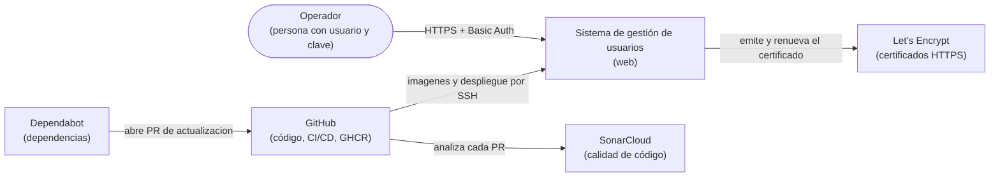
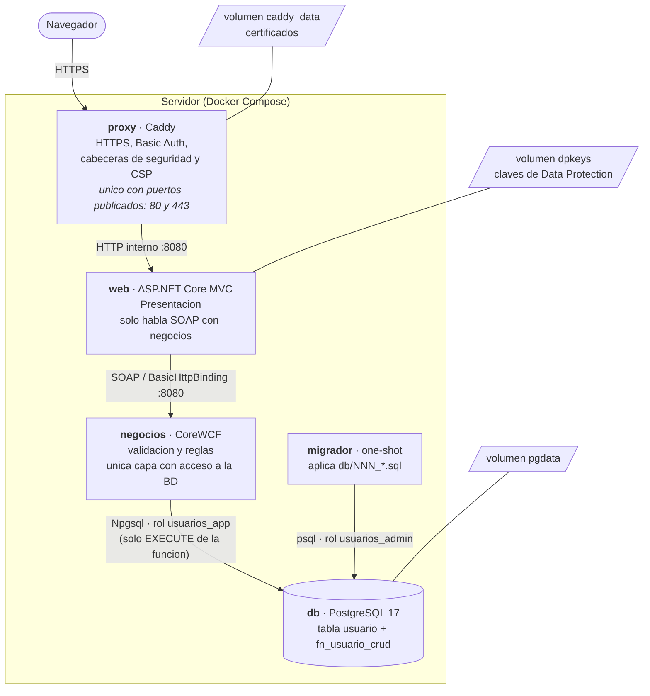
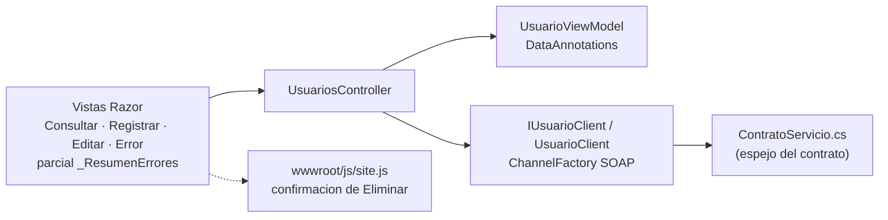
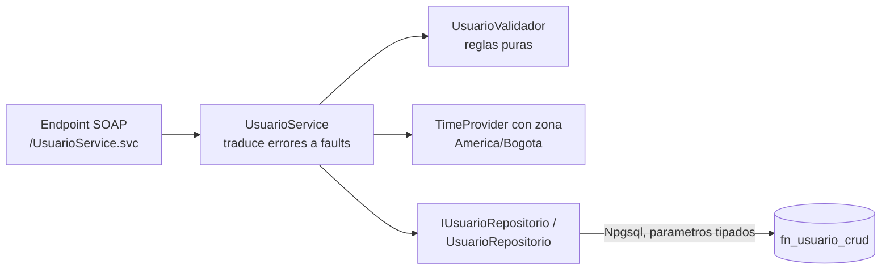
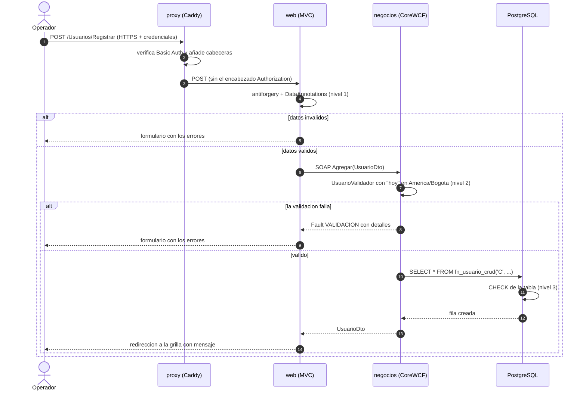
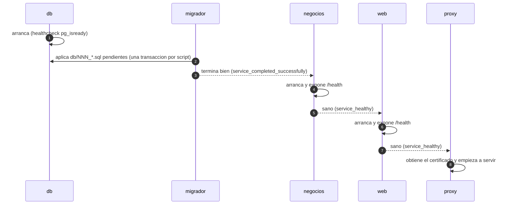
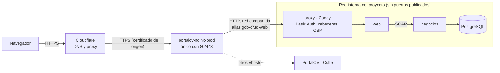

# Arquitectura

Vista de conjunto de GrupoDigitalBank-CRUD, siguiendo el modelo C4 (contexto, contenedores, componentes) más los flujos que importan. Los porqués de cada decisión están en los [ADR](adr/README.md). Los diagramas son [Mermaid](https://mermaid.js.org/) y se verifican con un motor real antes de publicarse.

> Estado: refleja `develop` al 2026-10-10. La **vista de despliegue en producción está decidida pero aún sin implementar** (sección 8.2, ADR 0011) hasta implementarla en la fase 7: parte de la infraestructura real del VPS, verificada el 2026-10-10, según el [plan de trabajo](plan-de-trabajo.md).

## 1. Propósito y alcance

Sistema de gestión de usuarios: registrar (nombre, fecha de nacimiento, sexo), consultar en una grilla, modificar y eliminar. Es deliberadamente pequeño; el interés está en la **arquitectura por capas** y en las prácticas de ingeniería alrededor: seguridad, migraciones, pruebas y despliegue reproducible.

Fuera de alcance: cuentas por persona y roles (ver [ADR 0004](adr/0004-autenticacion-minima-basic-auth.md)), paginación (#18) y alta disponibilidad (un solo servidor).

## 2. Contexto (C4 nivel 1)

El sistema no tiene integraciones de negocio con terceros: los externos son de plataforma (certificados, entrega y calidad).

## 3. Contenedores (C4 nivel 2)

| Contenedor | Tecnología | Responsabilidad | Expuesto |
|---|---|---|---|
| `proxy` | Caddy 2 | Termina TLS, exige usuario y clave (salvo `/health`), añade cabeceras y CSP, reenvía a `web` | 80 y 443 (único) |
| `web` | ASP.NET Core MVC, .NET 10 | Vistas Razor, formularios con antiforgery, cliente SOAP hacia `negocios` | Solo red interna |
| `negocios` | CoreWCF 1.9.1, .NET 10 | Servicio `UsuarioService` (Agregar, Modificar, Consultar, Eliminar), validación y traducción de errores a faults SOAP | Solo red interna |
| `db` | PostgreSQL 17 | Datos y la función `fn_usuario_crud(operación, …)` | Solo red interna (en desarrollo, `127.0.0.1:5432`) |
| `migrador` | `postgres:17-alpine` + `db/migrate.sh` | Aplica los scripts pendientes y termina; `negocios` no arranca si falla | — |

Reglas de dependencia (verificadas por el diseño y las pruebas, ver [`CLAUDE.md`](../CLAUDE.md)):

- **Presentación no referencia el proyecto Negocios**: solo conoce un contrato SOAP duplicado a mano ([ADR 0003](adr/0003-contrato-soap-duplicado.md)).
- **Negocios es la única capa con acceso a la base de datos**, y lo hace con un rol que solo puede ejecutar la función ([ADR 0008](adr/0008-rol-de-minimo-privilegio.md)).
- Solo `proxy` publica puertos: el servicio de negocios y la base no son alcanzables desde fuera.

## 4. Componentes (C4 nivel 3)

### 4.1 Presentación (`src/GrupoDigitalBank.Presentacion`)

`UsuarioClient` convierte cualquier fallo en `ServicioException` (un fault SOAP con detalles, o «no fue posible comunicarse con el servicio»), de modo que el controlador siempre muestra un mensaje amigable y nunca una excepción de WCF.

### 4.2 Negocios (`src/GrupoDigitalBank.Negocios`)

Códigos de fault estables: `VALIDACION`, `NO_ENCONTRADO`, `ERROR_DATOS` y `ERROR_INTERNO`. Los dos últimos **no revelan** detalles internos al cliente; el detalle técnico va al log.

## 5. Flujos

### 5.1 Registrar un usuario

Tres niveles de validación, cada uno por una razón distinta: la presentación da respuesta inmediata, negocios es la **fuente de verdad** de las reglas y la base es la última red frente a un cliente que se salte los anteriores. Cambiar una regla obliga a revisar los tres (ver [`CLAUDE.md`](../CLAUDE.md)).

### 5.2 Arranque ordenado por salud

Si una migración falla, `negocios` queda en `Created` y no arranca. `docker compose up --wait` espera de verdad a que todo esté sano.

## 6. Datos

- Tabla `usuario(id identity, nombre varchar(100), fecha_nacimiento date, sexo char(1))` con `CHECK` de sexo (`M`/`F`) y de fecha (entre 1900-01-01 y hoy en Colombia, `db/003`).
- Toda la lectura y escritura pasa por `fn_usuario_crud(p_operacion, …)` (`C`/`R`/`U`/`D`), declarada `SECURITY DEFINER` con `search_path` fijo ([ADR 0002](adr/0002-sin-orm-funcion-almacenada.md)).
- Esquema versionado en `db/NNN_*.sql` más `schema_migrations` con el checksum de cada script aplicado ([ADR 0007](adr/0007-migraciones-propias-con-checksum.md)). Un script aplicado nunca se edita.
- Dos roles: `usuarios_admin` (propietario, ejecuta las migraciones) y `usuarios_app` (solo `EXECUTE` de la función).

## 7. Seguridad por capas

| Capa | Mecanismo | Dónde |
|---|---|---|
| Red | Solo `proxy` publica puertos; `web`, `negocios` y `db` quedan en la red interna | `docker-compose.yml` |
| Transporte | HTTPS con certificado automático; HTTP redirige a HTTPS; HSTS configurable | Caddy ([ADR 0009](adr/0009-cabeceras-http-csp-y-hsts.md)) |
| Acceso | Basic Auth con hash bcrypt; `/health` abierto, nada más ([ADR 0004](adr/0004-autenticacion-minima-basic-auth.md)) | Caddy |
| Navegador | CSP sin nada en línea ni de otro origen, `nosniff`, `X-Frame-Options`, `Referrer-Policy`, COOP/CORP; también en los errores 401 y 502 | Caddy |
| Aplicación | Antiforgery con claves persistentes, sin JavaScript en línea, errores sin detalles internos | `web`, `negocios` |
| Datos | Rol de mínimo privilegio, parámetros tipados, `CHECK` en la tabla | `db/002`, Npgsql |
| Secretos | Fuera del repositorio: `.env` local, `user-secrets` en desarrollo, variables de entorno en contenedores; Negocios no arranca sin cadena de conexión | — |
| Cadena de suministro | Versiones fijas, Dependabot, alertas y correcciones automáticas de seguridad, Trivy y `dotnet list package --vulnerable` en el CI (fase 5) | `.github/` |

## 8. Despliegue

### 8.1 Desarrollo local (vigente)

| Modo | Qué corre en Docker | Cuándo |
|---|---|---|
| **A** | Todo el stack (`docker-compose.dev.yml`; la web en `http://localhost:8080`) | Validar de punta a punta antes de un PR |
| **B** | Solo `db`; Negocios (`:5081`) y Presentación (`:5080`) con `dotnet watch` o F5 | Programar y depurar a diario |
| **con proxy** | Todo más `proxy` con HTTPS local (`--profile con-proxy`) | Probar autenticación, cabeceras y CSP |

### 8.2 Producción (diseño aprobado, [ADR 0011](adr/0011-despliegue-detras-del-nginx-compartido.md))

El VPS es **compartido** con PortalCV y Colfe: un único nginx (`portalcv-nginx-prod`) publica 80 y 443 y Cloudflare va delante. Este proyecto no publica ningún puerto: su `proxy` (Caddy) se une a la red compartida con un alias y el nginx le enruta el subdominio. Las secciones 2, 3 y 7 describen lo que **hoy** hace el `docker-compose.yml` (Caddy con HTTPS propio); los cambios (Caddy en HTTP, sin `ports`) llegan con la fase 7 del plan.

| Aspecto | Diseño |
|---|---|
| Quién termina TLS | Cloudflare (navegador) y nginx (certificado de origen en `/etc/nginx/ssl/`); Caddy escucha solo HTTP |
| Enrutamiento | `docker/gdb-crud.conf` en el repo de PortalCV, con `resolver` + `set $upstream` para que un contenedor ausente no tumbe el nginx compartido |
| Despliegue | GitHub Actions → GHCR → SSH con una llave restringida a un script de entrada → `docker compose -p gdb-crud up -d` en `/srv/sitiosapps/gdb-crud` |
| Copias de seguridad | `deploy/backup.sh` (patrón de Colfe) en `/srv/sitiosapps/_backups/gdb-crud`, con cron y restauración probada |
| Pendiente de verificar | Que el `X-Forwarded-Proto` y la IP del cliente atraviesen los dos proxies (nginx y Caddy) sin perderse |

## 9. Calidad y verificación

- **192 pruebas** (90 unitarias de Negocios, 32 de integración con PostgreSQL real en Testcontainers y 70 de Presentación con `WebApplicationFactory`), cobertura de Negocios 100 % de líneas y ramas con mínimo exigido del 80 % ([ADR 0010](adr/0010-estrategia-de-verificacion.md)).
- 34 mutaciones manuales aplicadas al código de producción, todas detectadas.
- Herramientas en `scripts/`: `verificar.ps1` (el contrato del CI), `cobertura.ps1`, `probar-migrador.ps1`, `probar-acceso.ps1` y, en navegador real, `probar-navegador.ps1`.
- Integración continua con GitHub Actions: **pendiente** (fase 5, #20). Hoy lo único automático en GitHub es SonarCloud (análisis por PR) y Dependabot.

## 10. Decisiones y deuda conocida

Índice de decisiones en [adr/README.md](adr/README.md). Pendientes abiertos que afectan a la arquitectura:

| Tema | Issue |
|---|---|
| `CHECK` de nombre vacío en la base | [#41](https://github.com/maomauro/GrupoDigitalBank-CRUD/issues/41) |
| Prueba del cliente SOAP contra un servidor CoreWCF real y del contrato duplicado | [#19](https://github.com/maomauro/GrupoDigitalBank-CRUD/issues/19) |
| Integración continua | [#20](https://github.com/maomauro/GrupoDigitalBank-CRUD/issues/20) |
| VPS y despliegue (incluye la decisión de proxy de la sección 8.2) | [#21](https://github.com/maomauro/GrupoDigitalBank-CRUD/issues/21), [#22](https://github.com/maomauro/GrupoDigitalBank-CRUD/issues/22) |
| Backups, monitoreo y runbook | [#23](https://github.com/maomauro/GrupoDigitalBank-CRUD/issues/23) |
| Paginación de la grilla | [#18](https://github.com/maomauro/GrupoDigitalBank-CRUD/issues/18) |
